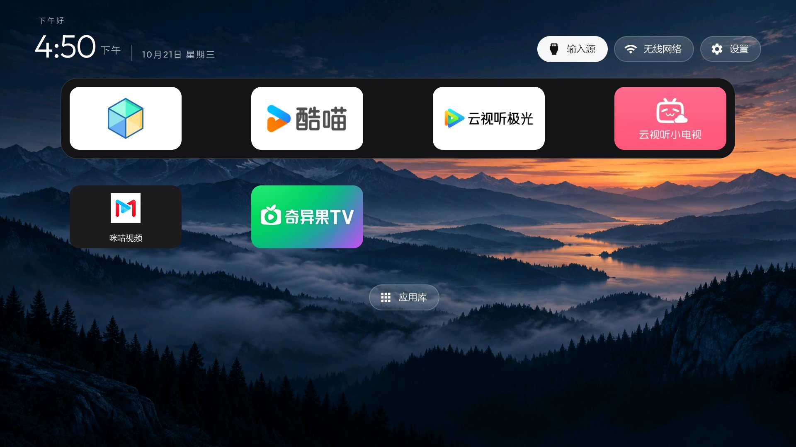

# Haier HRA962X2_2G_ALI6G_A (China): launcher, physical Home and settings overlay

One-day field report, tested on 2026-10-21 using a locally adapted CleanYourTV
v2.5.0 launcher. **The stock v2.5.0 APK does not include the Home/boot/settings
adaptations described below.** This is a reproducible device note, not a claim
that all Haier TVs work the same way or a several-day debloat recommendation.
No root, flashing or factory-menu changes were used.



## Identify this firmware

| Field | Observed value |
|---|---|
| Brand / manufacturer | Haier / `haier` |
| `ro.product.model`, `.device`, `.name` | `HRA962X2_2G_ALI6G_A` |
| Android SDK | `28` (Android 9) |
| `ro.build.version.release` | `9.0.0-RS-20230315.0915` (vendor version string) |
| `ro.build.display.id` | `PPR1.180610.011.20220620 test-keys` |
| `ro.product.cpu.abilist` | `armeabi-v7a,armeabi`; no 64-bit ABI |
| RAM | `MemTotal: 2054120 kB` |
| Storage | Settings reports 16 GB physical storage; this is not RAM |
| Stock content app | Coolme / 华数酷喵 `13.5.3.7`, `com.youku.taitan.tv` |
| Original preferred HOME | `com.haier.tv.provision/.DefaultActivity` |
| Live TV package | `com.droidlogic.droidlivetv` |

The API level and RAM were read over ADB, not inferred from the firmware string
or the `2G` in the model identifier. The launcher builds and runs on this ABI.
Other Haier models in `examples/` use different platforms and package sets.

## Install through the ordinary installer UI

After the owner enabled ADB debugging, network ADB on port 5555 worked. This
unit reported `ro.adb.secure=0` and did not show an authorization prompt. Keep
ADB on a trusted LAN and turn debugging off when finished.

Direct `adb install` / package-manager sessions stalled while waiting for
Haier's installation UI. The reliable path was to push the APK and open the
normal installer, then accept its on-screen confirmations:

```sh
adb connect <tv-ip>:5555
adb -s <tv-ip>:5555 push launcher.apk /sdcard/Download/CleanYourTV.apk
adb -s <tv-ip>:5555 shell am start -W \
  -a android.intent.action.VIEW \
  -t application/vnd.android.package-archive \
  -d file:///sdcard/Download/CleanYourTV.apk -f 0x10000001
```

The package installer initially showed `正在检查安装包` (checking the package),
then `继续安装` (continue installation). Haier's `com.yunos.tvmgr` also showed
a `安全风险` confirmation. Wait for the button to become enabled; repeatedly
issuing installation commands leaves duplicate requests. Update installation
preserved the launcher's data. Verify the installed version with
`dumpsys package com.gathin.tvhome` rather than relying on the dialog alone.

Wake/dismiss the screensaver before opening the installer. An installer can
be running behind it while `uiautomator dump` shows only the screensaver.
Dump UI XML to a file and pull it to the host; fixed coordinates are not a
portable installation procedure.

## Default HOME, physical Home and boot are three separate checks

Before changing anything, record these values and the enabled state of every
package to be changed:

```sh
adb -s <tv-ip>:5555 shell cmd package resolve-activity --brief \
  -a android.intent.action.MAIN -c android.intent.category.HOME
adb -s <tv-ip>:5555 shell settings get secure enabled_accessibility_services
adb -s <tv-ip>:5555 shell settings get secure accessibility_enabled
adb -s <tv-ip>:5555 shell dumpsys package com.haier.tv.provision
```

`com.haier.tv.provision/.DefaultActivity` claimed HOME with priority 1. On this
unit its small APK declared only that activity, with no services, receivers
or providers. Disabling the individual system component was refused; disabling
the package for user 0 worked. Only after the new launcher had been installed
and explicitly started, the tested handover was:

```sh
adb -s <tv-ip>:5555 shell pm disable-user --user 0 com.haier.tv.provision
adb -s <tv-ip>:5555 shell cmd package set-home-activity --user 0 \
  com.gathin.tvhome/.MainActivity
```

Coolme and `com.yunos.tv.alihomeshell` remained enabled as recovery paths.
Package disabling preserved APKs and data. Do not copy this step to another
firmware without checking what its provision package contains.

**Preferred HOME alone was insufficient.** The physical remote still opened
Coolme. In the local build, the existing `HomeKeyService` was extended to accept
`KEYCODE_HOME` as well as `KEYCODE_ALL_APPS`, using its existing ACTION_UP /
not-cancelled check and explicit launcher HOME intent:

```java
if (event.getKeyCode() != KeyEvent.KEYCODE_ALL_APPS
        && event.getKeyCode() != KeyEvent.KEYCODE_HOME) return false;
```

Enable that service in Accessibility, preserving any previously enabled
services. Do not overwrite an existing colon-separated service list with just
this app. On the tested unit there were no previously enabled accessibility
services. The owner physically pressed Home and confirmed that it returned
to the new launcher.

`adb shell input keyevent 3` still opened Coolme on this firmware even after
the physical remote worked. Injected events did not exercise the same
accessibility key-filter path. A simulated Home result is therefore not a
substitute for checking the actual remote.

**Boot was another independent path.** The vendor boot flow explicitly opened
Coolme despite the preferred HOME. The local adaptation used the *existing*
accessibility service's `onServiceConnected()` to read Global `boot_count`,
compare it with a private `last_home_boot` preference, and schedule one launch
of `MainActivity` after 8 seconds. The delayed callback rechecked and saved
the boot count before launching. Reconnecting the service in the same boot
did not schedule another takeover while watching video. No new polling or
background service was added. A reboot was checked separately: the adapted
launcher became foreground and the owner confirmed the TV displayed a home
screen normally. After the owner subsequently powered the TV off and on, the
settings update (local versionCode 9) was checked too: the new launcher became
foreground, its Home accessibility service was enabled and bound, and the
owner again confirmed the physical Home button returned to the new launcher.
The installed APK matched the locally built APK's SHA-256.

The core of that local `onServiceConnected()` addition was:

```java
int boot = Settings.Global.getInt(getContentResolver(), "boot_count", -1);
android.content.SharedPreferences startup =
        getSharedPreferences("haier_startup", MODE_PRIVATE);
if (boot >= 0 && startup.getInt("last_home_boot", -2) != boot) {
    new android.os.Handler(android.os.Looper.getMainLooper()).postDelayed(() -> {
        if (startup.getInt("last_home_boot", -2) == boot) return;
        startup.edit().putInt("last_home_boot", boot).apply();
        startActivity(new Intent(this, MainActivity.class)
                .addFlags(Intent.FLAG_ACTIVITY_NEW_TASK
                        | Intent.FLAG_ACTIVITY_RESET_TASK_IF_NEEDED));
    }, 8000);
}
```

These adaptations should become opt-in configuration if implemented in the
shared launcher. Do not globally intercept Home or force a startup launch for
other TVs. A production implementation should also consider delayed unlock
and a user intentionally starting a video during boot; those cases were not
tested in this session.

## Settings is an overlay service, not RootActivity

Two tempting entry points were wrong on this firmware:

- `android.settings.SETTINGS` resolved to
  `com.haier.bluetooth.settings/.SettingsActivity` (Bluetooth only).
- `com.haier.tv.menusetting/.RootActivity` belonged to the legacy source/menu
  package. Opening it from the launcher returned the owner to the signal-source
  screen instead of full settings.

The actual settings UI was in **`com.haier.tv.menusetting.ui`**, a separate
package. Its exported `SettingsService` accepts the following ordinary service
intent; `command=0` is essential:

```java
Intent settings = new Intent("com.haier.settings.intent.action.SettingsService")
        .setClassName("com.haier.tv.menusetting.ui",
                "com.haier.tv.menusetting.ui.SettingsService")
        .putExtra("command", 0);
context.startService(settings);
```

An ADB-only diagnostic for that same panel is:

```sh
adb -s <tv-ip>:5555 shell am startservice \
  -n com.haier.tv.menusetting.ui/.SettingsService \
  -a com.haier.settings.intent.action.SettingsService --ei command 0
```

This opened an overlay with **图像 / 声音 / 节能 / 系统** (Picture / Sound /
Energy saving / System). Back dismissed the overlay and returned to the
CleanYourTV homepage. The local fix routed the top-right Settings button,
Launcher settings' TV-settings item, the remote settings key, and the quick
panel's TV-settings row through one helper. The **top-right button and Back**
were exercised on the installed update; the other routes share the helper
but were not individually tested with the physical remote.

The similarly named broadcast `com.haier.tv.menusetting` was denied as a
protected broadcast to the shell. It is unnecessary: use the exported service
instead. No permission or verification checks were disabled.

## Appearance and app shortcuts

The dock and a static wallpaper used existing launcher configuration. A local
video app appeared under an unexpected package ID; its visible label and launch
activity were checked before pinning it, and the first tile was activated with
D-pad navigation to verify it opened the intended app. Do not assume an app's
package name from its visible label.

For this platform the Live TV theme values were `live_tv_package` =
`com.droidlogic.droidlivetv` and `live_tv_action` = `android.intent.action.MAIN`.
That identifies a launch route; HDMI cables and tuner reception were not
individually tested.

Static wallpapers work via
`/sdcard/Android/data/com.gathin.tvhome/files/wallpaper.jpg`; the existing
Launcher settings wallpaper picker can select a picture or no wallpaper.
Use a dark, quiet image so the clock and app labels remain readable. There is
no need for a network wallpaper service or animated background. Restarting the
launcher to reload a file can affect the accessibility service: after a forced
stop, recheck that the Home service is still enabled and bound. The TV went
offline when the owner powered it off. After the next power-on, the service
was independently confirmed bound, the wallpaper was still visible in a pulled
screenshot, and the top-right Settings / Back flow passed again. The wallpaper
file's SHA-256 still matched the original image. No repair commands were needed
during this follow-up check.

## Same-day package observations, not a ready-to-run debloat list

The following seven packages were disabled with `pm disable-user --user 0`;
their data and APKs were retained. Education, fitness and games were removed
only after the owner chose to give up those features.

| Package | Identified role | Original enabled state |
|---|---|---|
| `com.yunos.advert.service` | Advertising service | 1 (explicitly enabled) |
| `com.haier.tv.modelintroduction` | Product demonstration | 1 |
| `com.yunos.tv.edu` | Education | 1 |
| `com.health.aisportcoach` | Fitness | 0 (manifest default) |
| `com.nibiru.play` | Motion games / game peripherals | 0 |
| `com.nibiru.alipaytv` | Game payment | 0 |
| `com.haier.tv.speakingtest` | Spoken-English learning | 0 |

The disabled states survived a reboot. This is **one session**, not several
days of normal use; there is deliberately no executable `examples/` list yet.
`com.yunos.tv.probe` was identified as **network diagnostics** and retained;
its name alone was not a reason to call it telemetry. Existing video apps,
casting, voice, input, Bluetooth and OTA packages were retained. Retaining a
package is not proof that casting, voice or HDMI works: those were not fully
tested. No controlled performance measurement or claim about in-app/boot ads
was made.

## Restore the exact pre-change state

The original state of `com.haier.tv.provision` was 0 (manifest default), so its
matching restore is `pm default-state`, followed by restoring the original
preferred HOME:

```sh
adb -s <tv-ip>:5555 shell pm default-state --user 0 com.haier.tv.provision
adb -s <tv-ip>:5555 shell cmd package set-home-activity --user 0 \
  com.haier.tv.provision/.DefaultActivity
```

Restore `enabled_accessibility_services` and `accessibility_enabled` to their
saved values as well. If a key was absent (`null`), delete it rather than
writing the literal string `null`. For each optional package above, use
`pm enable --user 0 PACKAGE` when its saved state was 1, or
`pm default-state --user 0 PACKAGE` when it was 0. Re-read the resulting HOME
and package states. Restoring only the seven optional packages does not undo
the separate HOME/accessibility changes.

Recovery scripts were syntax checked and exercised with PowerShell `-WhatIf`
against this TV; an actual full rollback was not performed. No device IP,
MAC address, UUID, serial number, raw settings dump or signing/ADB keys are
included in this report.
