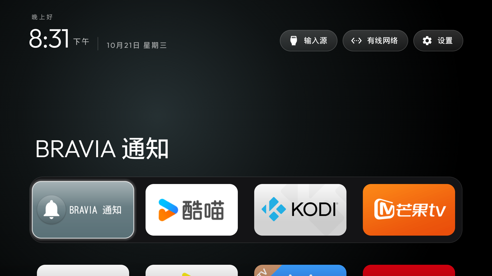

# Sony X9000H (China firmware): launcher handover and debloat notes

Owner report for a China-market X9000H. The retail model was supplied by the owner; Android exposes
the platform model, so a different regional X9000H may behave differently. A tested package list for
this unit lives in [`examples/sony-x9000h-cn/debloat.txt`](../../examples/sony-x9000h-cn/debloat.txt).



## Observed firmware

| Field | Observed value |
|---|---|
| Owner-reported retail model | Sony X9000H (KD-55/65/75X9000H family) |
| Manufacturer | `Sony` |
| Android model / product | `BRAVIA VH1` / `BRAVIA_VH1` |
| Device | `BRAVIA_VH1` |
| Android / API | `12` / `31` |
| Build fingerprint | `BRAVIA_VH1_CN-user 12 STT2.230505.001.S89 625561 release-keys` |
| Security patch | `2025-09-01` |
| Application ABIs | `armeabi-v7a` |
| RAM | 2,997,592 kB (~2.9 GB) |
| Google client ID | `android-sonyfy20-tv` (China firmware: no GMS, no Play Store) |
| SoC | MediaTek MT5895 (as reported by the owner) |

`ro.build.characteristics` is `nosdcard,tv`. The `_CN` suffix appears in the fingerprint and build
display id only; `getprop ro.product.model` reports the generic `BRAVIA VH1`.

## Stock Home and handover

The stock Home component on this unit was:

```text
com.dangbei.TVHomeLauncher/com.dangbei.leard.leradlauncher.ui.sony.main.MainActivity
```

It is 当贝桌面 ("电视桌面"), a system priv-app at
`/system/system_ext/priv-app/ChinaHome.apk`. This firmware ships no Google TV / Android TV launcher;
应用中心 is `com.sony.dangbeimarket`, a Dangbei store. Because Dangbei is not one of
`build-and-install.sh`'s `KNOWN_STOCK_LAUNCHERS`, the script would refuse to guess it. The launcher
was therefore built from main and installed with:

```sh
adb install -r launcher/app/build/outputs/apk/release/app-release.apk
adb shell am start -W -a android.intent.action.MAIN -c android.intent.category.HOME -n com.gathin.tvhome/.MainActivity      # Status: ok, cold start 926 ms
adb shell cmd package set-home-activity --user 0 com.gathin.tvhome/.MainActivity
```

Dangbei was left enabled as the fallback (`STOCK_LAUNCHER=none`). After a `svc power reboot`:

- `cmd package resolve-activity --brief -a android.intent.action.MAIN -c android.intent.category.HOME`
  still resolved to `com.gathin.tvhome/.MainActivity`;
- the launcher was the focused window after boot;
- the Home key returned to it from the system Settings and from the input panel.

The restore target is the Dangbei component above. It was never disabled, so restoring Home is a
single `set-home-activity` call once the reference launcher is uninstalled.

## Live TV and HDMI

- Live TV / player package: `com.sony.dtv.tvx`, launcher activity `com.sony.dtv.tvx/.MainActivity`.
- `KEYCODE_TV_INPUT` opened a `com.android.systemui` input window and Home returned to the reference
  launcher, so the launcher's optional `InputKeyService` was not enabled.
- The input framework itself was not exercised further: no HDMI source was switched and tuner
  reception was not checked.

Keep `com.sony.dtv.tvinput.*`, `com.sony.dtv.tvapi`, `com.sony.dtv.sonysystemservice`,
`com.sony.dtv.sonyvendorservice`, `com.sony.dtv.settingsprovider`,
`com.sony.dtv.systemupdate`/`update`, `com.sony.dtv.braviasync*`, `com.sony.dtv.partnerkeycn` (it
holds enclave/DRM keys) and all `com.mediatek.*`. They drive HDMI, the tuner, DRM, OTA, CEC and the
remote.

## Debloat notes

- 33 packages were disabled with `pm disable-user` (nothing uninstalled) and reboot-checked; five
  more were already disabled at the factory (`mysony`, `livingfit`, `iot`, `b2b.vendorprotocol`,
  `b2b.softap`). The list is in `examples/sony-x9000h-cn/`.
- This China build has **no** Samba TV (`tv.samba.ssm`), no Google feedback package and no
  `com.sony.dtv.promos` / `sonyselect` / `sonytab`. There is no Sony ACR or advertising ID to
  remove here. The ad surfaces are the Dangbei home/store, HappyCast and the preinstalled content
  apps.
- Kept by the owner: `com.sony.dangbeimarket` (应用中心), `com.hpplay.happyplay.aw` (乐播投屏 —
  the only casting path without Google Cast) and `com.dangbei.TVHomeLauncher`.
- `com.sony.dtv.b2b.hotelmode` is `PERSISTENT`. `pm disable-user` sets `enabled=3` and its
  components stop, but system_server still starts its process after a reboot (~6 MB PSS, measured
  with `dumpsys meminfo`). Do not expect the process to disappear; the package is still disabled.
- Disabling `com.sonyericsson.idd.agent` stops the Java agent, but the native `iddd` and
  `idd-logreader` daemons (vendor `vendor.semc.system.idd`) keep running. Only root stops those.

## Validation scope

Checked over several days of use:

- APK install, explicit launcher start (`Status: ok`), preferred-Home resolution, Home-key return
  from Settings and from the input panel;
- all 33 disables survived a `svc power reboot` (`pm list packages -d` still showed them);
- the kept Dangbei store, HappyCast and Dangbei Home were still enabled;
- no new crash appeared in `logcat -b crash` that was attributable to the disabled packages. The
  boot log does contain pre-existing firmware crashes in `com.sonyericsson.dlna`,
  `com.android.statementservice` and `com.mediatek.dmagent`, unrelated to this list.

Not checked: cold boot from mains power-off, actual HDMI input switching, casting, voice input,
tuner reception, DRM/Netflix playback, factory reset.

This report omits the network address, serial numbers, Android ID and account details.
